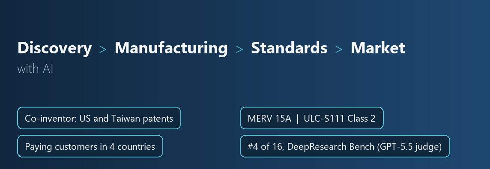

# Aldrin Or

I co-founded C-POLAR, the health science company behind patented NanoFlashing™ technology, and I am a co-inventor of the technology. I also co-founded Deep Cove Research, as Chief Architect.

[deepcove.tech](https://deepcove.tech) · [cpolar.tech](https://cpolar.tech) · [LinkedIn](https://www.linkedin.com/in/aldrinor/)

<table>
<tr>
<td valign="top" width="55%">

### Building now

**[Deep Cove Research](https://deepcove.tech)** · Co-founder & Chief Architect · since July 2026

Deep Cove Research is a comprehension engine built on Read-Time Compute. It comprehends full sources, then turns them into research reports at the level of frontier models, for much less cost.

**[C-POLAR](https://cpolar.tech)** · Co-Chief Innovation Officer · since June 2023

I co-founded C-POLAR, the health science company behind patented NanoFlashing™ technology, and I am a co-inventor of the technology.

</td>
<td valign="top" width="45%">

### Milestones

**Oct 2026** #4 of 16 on DeepResearch Bench (GPT-5.5 judge)

**Jul 2026** Patent granted: US 12,678,542 B2

**May 2025** Patent granted: TW I882291 B

**Sep 2024** [Paper](https://doi.org/10.1128/spectrum.04097-23) in Microbiology Spectrum

</td>
</tr>
</table>

## Selected work

- Ranked #4 of 16 on the official DeepResearch Bench leaderboard (GPT-5.5 judge), with a score of 55.29 (10 October 2026). DeepResearch Bench (ICLR 2026) has 100 PhD-level research tasks, written by experts in 22 fields, in Chinese and English.
- Up to 93% lower cost than frontier deep research agents, at about US$1.04 per report at public API prices. [See all 100 reports](https://github.com/aldrinor/deep-cove-research).
- Co-inventor of NanoFlashing™ on granted patents in the US (US 12,678,542 B2, 2026) and Taiwan (TW I882291 B, 2025), with two further US applications pending and the patent family filed in Europe, China, Japan, Canada and Australia. For one pending application, I drafted all 17 claims and the figures.
- Took NanoFlashing™ from the lab into production with manufacturing partners, including two synthetic filter media and a water-filtration medium scaled from a 100 kg batch to two 200 kg factory batches. A partner-made pocket filter was rated MERV 15A under ASHRAE 52.2, and pocket and pleated filters met ULC-S111 Class 2.
- Designed and directed Project Crucible, a GPU molecular-simulation screen to accelerate materials development. In about three months, for about US$350, it screened 587 candidate bonding conditions on seven medical-device surfaces down to a shortlist of 16, cutting the candidates for lab testing by 97%. C-POLAR has since used the shortlist in product development.
- [Effect of multifunctional cationic polymer coatings on mitigation of broad microbial pathogens](https://doi.org/10.1128/spectrum.04097-23). Microbiology Spectrum (American Society for Microbiology), 3 September 2024.

## Previously

- **Co-founder and CEO, C-POLAR** · February 2020 – May 2023. Co-founded C-POLAR in Hong Kong and led the Hong Kong company, C-Polar Biotech Limited, as CEO.
- **Visiting Collaborator (by invitation), Massachusetts General Hospital** · 2025 – 2026. Invited by a laboratory in the Division of Infectious Diseases at Massachusetts General Hospital and Harvard Medical School, for studies of fungal control with air filters and textiles (summer 2025 to summer 2026).
- **Co-founder and General Manager, Print-Easy** · January 2010 – February 2020. Co-founded and ran Print-Easy, a Hong Kong commercial printing business, and built it to 40 employees and two factories in Shenzhen and Shanwei, China.

## Awards

- Hong Kong Awards for Industries 2021-22: Innovation and Creativity Grand Award (December 2021)
- Qianhai Guangdong-Hong Kong-Macao-Taiwan Youth Innovation and Entrepreneurship Competition 2021: Bronze Award (December 2021)
- 13th China Shenzhen Innovation and Entrepreneurship Competition: Award of Merit (October 2021)
- HICOOL 2021 Global Entrepreneurship Competition: Third Prize (September 2021)
- Hong Kong ICT Awards 2021: Smart Living Grand Award and Smart Living (Smart Healthcare) Gold Award
- WeVenture Greater Bay Area Youth Entrepreneurship Programme 2021
- The Enginpreneurs Award 2021: Champion (June 2021)

## Education

The Hong Kong University of Science and Technology. Bachelor of Engineering (BEng), Logistics Management and Engineering, 2006 – 2009.

This page is built automatically from my LinkedIn profile.
